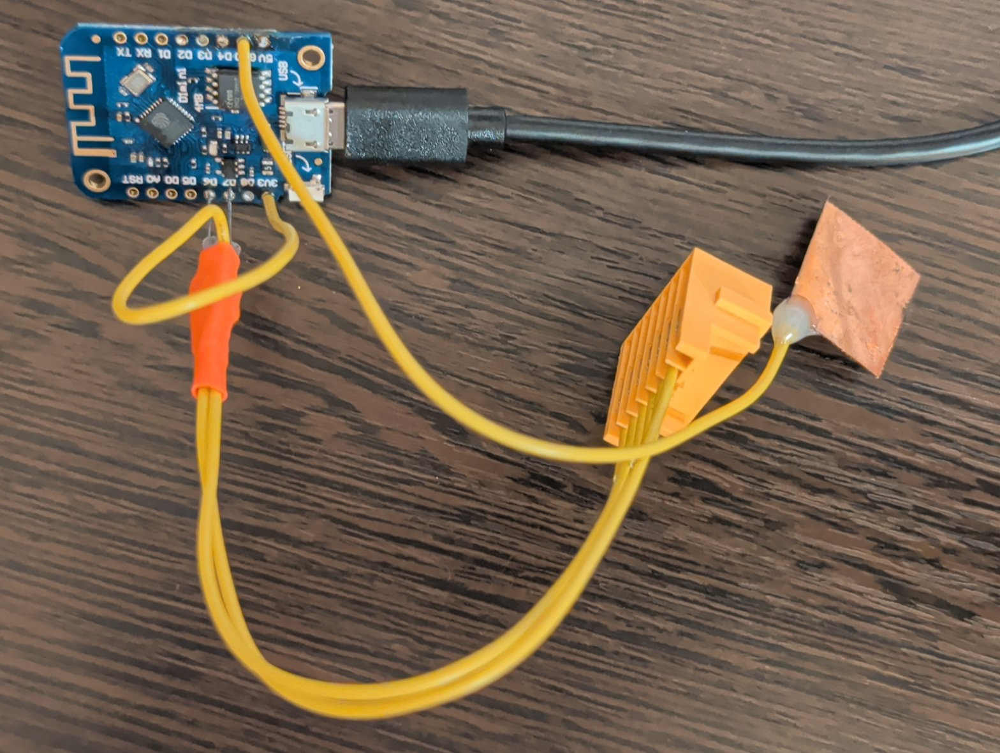

# makita_obi

Read and service Makita LXT 18 V batteries with a Wemos D1 mini (ESP8266) and a Python command line tool.

The firmware is based on ArduinoOBI from [Open Battery Information](https://github.com/mnh-jansson/open-battery-information)
and stays compatible with its web tool. It adds a session mode that holds Enable high across several commands,
which frame writes need.

## Wiring

See [docs/wiring.svg](docs/wiring.svg).



| Battery | D1 mini | Note |
|---|---|---|
| Connector position 6, Enable | D6 (GPIO12) | 4.7 kΩ pull-up to 3V3 |
| Connector position 2, 1-Wire | D7 (GPIO13) | 4.7 kΩ pull-up to 3V3 |
| Main `−` terminal | GND | Shared ground, a thick copper foil tab fits the slot |

Position 1 of the yellow connector is the end closest to the negative battery terminal. Never pull these lines up
to 5 V and never connect the main `+` terminal to the D1 mini.

## Install

```bash
uv venv venv
uv pip install --python venv/bin/python -e '.[dev]'
uvx --from platformio pio run -t upload --upload-port /dev/ttyUSB0
```

## Use

```bash
venv/bin/makita-tool info                  # read everything, changes nothing
venv/bin/makita-tool info --json
venv/bin/makita-tool monitor --interval 10
venv/bin/makita-tool unlock --dry-run      # show what an unlock would do
venv/bin/makita-tool unlock
venv/bin/makita-tool reset-errors
venv/bin/makita-tool led-test
venv/bin/makita-tool restore FILE          # write a backup frame back to the same pack
venv/bin/makita-tool exit-test-mode        # recover a pack left in test mode
venv/bin/makita-tool raw cc d7 0e 00 02 --read 3
```

Close the OBI web tool first, because only one program can hold the serial port.

## Web tool

The same tool runs in a browser at <https://visualgadget.github.io/makita_obi/>, with nothing to install except the firmware on the board. It needs a browser with Web Serial, such as Chrome, Edge or Firefox.

The page runs the Python package from this repository in [Pyodide](https://pyodide.org/), so its decoding, fake pack detection and unlock refusals are the same code as the command line tool. Nothing about the battery is uploaded.

The page also installs the firmware on the board, using [ESP Web Tools](https://esphome.github.io/esp-web-tools/). Take the battery off the adapter first.

It reads reports, monitors live values and unlocks. It has no raw commands and no `restore`, so it cannot write an arbitrary frame. An unlock asks you to download a frame backup and type a confirmation first, and it is refused if the pack changed after the check. To put a backup back, use `restore` from the command line tool.

To run it locally:

```bash
pio run
python3 scripts/build_web.py
python3 -m http.server -d _site 8000 --bind 127.0.0.1
```

## Safety

- Reading sends documented read commands only. Test mode needs an explicit `--probe-test-mode`.
- Writes ask for confirmation, and `unlock` saves the frame to `~/.local/state/makita_tool/backups` first.
- `unlock` clears a false lockout on a healthy pack. It refuses a pack that reports itself dead, has a cell failure
  flag, has a cell below 3.0 V, has more than 0.3 V imbalance, is above 60 °C, or has an unknown controller type.
- `unlock` tries the error reset first and only writes the frame if the pack is still locked.
- `unlock` never clears the dead failure code or writes a changed cycle count, but its `DA 04` step can reset history, see below.
- `restore` only undoes an unlock: it refuses a backup that differs from the pack outside the lock fields.
  `--allow-history` lifts that for a valid backup of the same pack, to put back its own history. Use it only for that,
  and do not misrepresent the history of a pack you sell or pass on.
- A write stops if test mode is refused, the pack does not arm, or the ROM id changes. The pack arms once per
  insertion, so reinsert it before retrying.
- Public notes say a pack in test mode cannot power tools or charge. The tool always leaves test mode, and on the
  tested BL1850 holding Enable low for 2 s also ended it.
- `reset-errors` wipes battery history, and `unlock` runs the same `DA 04` step first. On a real BL1850 (type 2) `DA 04` also reset the charge cycle count from 35 to 0 and the damage rating from 1 to 0, and changed frame bytes 15, 21, 23, 27, 29 and 31, even though the failure code was already OK. The change survived a power cycle. The pack stayed unlocked. Whether other counters are cleared is unknown.
- F0513 (type 5) packs are read only. They have no LED test, error reset or working frame write.
- `raw` refuses `99` and `10 21`, even with `--yes`. On F0513 packs `99` opens a command tree that includes a fuse
  trigger and a massive reset, and `10 21` overwrites the ROM id. Do not send other unknown commands to a battery.
- Lithium-ion packs can be dangerous. A lockout is often real protection, so do not charge a pack you do not trust.

## Status

Read commands and entering and leaving test mode are tested on a real 2014 BL1850 that reports no model and has no
LEDs, so the LED commands ran but their effect was not seen: they replied `07`, not the usual `06`.
A full lock test passed on the same BL1850:

1. `restore` wrote a frame with nybble 34 set to 1 and valid checksums, and the charger refused the pack with
   alternating red and green lights.
2. `unlock` cleared the lock with its `DA 04` step alone, so it wrote no frame, and the pack charged normally. `DA 04`
   left the same frame both times it ran, so it seems to write fixed reset values, including the charger lock.
3. `restore --allow-history` put the original frame back, 35 cycles included.

`restore` wrote a frame three times, and the first write survived reinsertion and charging. The pack did not
acknowledge the exit from test mode after the first store. The branch of `unlock` that writes a repaired frame is
covered by simulated tests only. Support for controller types other than this pack is implemented
from public notes and is untested.

## Packs that only imitate the interface

A third party TPCELL "BL1850B" (18 V, 5.0 Ah, 90 Wh, label charging limit 20.75 V) answers `cc aa 00` with a fixed
frame and nothing else, which may be all a charger needs:

```text
F1 36 B6 C3 18 58 00 00 94 94 40 21 01 80 02 09 43 D0 8E 1B F0 65 00 00 00 00 00 00 00 00 00 00
```

- The frame was identical on every read. It claims 5.2 Ah, 0 cycles and failure code OK, and has no lock causes.
- `33` reads, `d7` voltages, `d4` and the `dc` probes all return `FF`, so this pack reports no ROM id, cell voltages,
  temperature or cycles.
- It shares 25 of 32 bytes with a real BL1850, including the first 15, so it may be copied from a genuine pack.
- A Fluke 87V read 20.74 V at the pack terminals. Only a meter can check such a pack without opening it.

`info` prints this frame with a warning. `monitor`, `led-test`, `reset-errors`, `unlock` and `restore` refuse packs without a ROM id, while `raw` and `exit-test-mode` are not blocked. The frame
says nothing about the cells, and this test does not show whether the pack has cell protection.

A different pack carries fake Makita labels: "BL2110B", 21 V, 10.0 Ah, 210 Wh, cell code `5INR19/66-2`, with a charge
indicator. It has 21700 cells inside and about the labelled capacity, so the cell code on the case is false. It behaves
differently from the TPCELL:

- After each Enable it sends one burst, even with no command at all, and every later read is blank. It has no ROM id,
  cell voltages, temperature or model.
- Its timing drifts against the reader, adding 24 to 31 extra bits per burst, so no two captures look the same.
- The frame below was rebuilt offline. It fits 12 of 16 captures bit by bit, the other 4 used `33 aa 00`, which
  writes during the burst, and its checksums pass:

```text
F1 26 BD 13 14 58 00 00 94 94 40 21 D0 80 02 08 C3 D0 8E 67 60 F0 00 01 02 02 0E 00 00 00 00 21
```

- It claims a 6.0 Ah BL1860B with 0 cycles and failure code OK. It differs from a real BL1860B only at bytes 15, 21,
  23, 27, 29 and 31, the bytes `DA 04` changed on a real BL1850, so it may be a genuine frame with its history cleared.
- A Fluke 87V read 18.03 V when about half charged.

`read_frame` reads twice, and a second read that differs stops every command that reads the frame, including `info`.
The tool does not rebuild this frame itself.

## Disclaimer

This is an independent project, not affiliated with or endorsed by Makita. Makita and product names are used only to
describe compatibility, and all trademarks belong to their owners.

The tool writes to lithium battery packs, and a wrong write can disable a pack. Use it at your own risk: see the licence
for the warranty terms.

## Credits

Protocol facts come from [makita-lxt-protocol](https://github.com/rosvall/makita-lxt-protocol) by rosvall, Open
Battery Information by Martin Jansson, and the public notes of PocketOBI, makita-battery-tools and
Makita-LXT-Battery-Monitor-Unlocker. No code from those last three projects is included.

`lib/OneWire` is the OneWire library for Arduino, under the licence in `lib/OneWire/OneWire2.cpp`.
